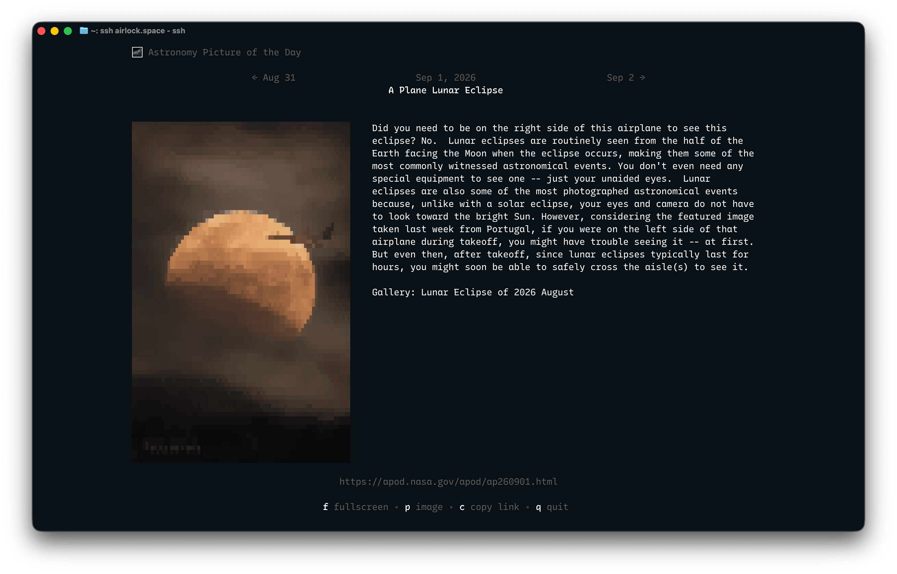

# airlock.space

NASA's [Astronomy Picture of the Day](https://science.nasa.gov/apod/) served to your terminal as a TUI over SSH.

```sh
ssh airlock.space   # no installation needed :)
```


<p align="center">
  
</p>

Terminals that speak the kitty graphics protocol (kitty, Ghostty, Rex) get the
real photograph; `p` switches between it and the art. Run locally or in the
browser, the photo is the default and your choice holds as you browse days.
Over SSH the photo is megabytes down the wire, so each day starts as art on
larger windows.

<p align="center">
  
</p>

## Running locally

```sh
go run ./cmd/airlockspace
```

## Self-hosting

### NixOS

See: [NixOS deployment guide](docs/nixos-deployment.md).

### systemd

* `airlocksshd` runs as a systemd service with `DynamicUser=yes` - a transient unprivileged user.
* `airlocksshd.socket` allow systemctl to bind to port 22 and hand the listener over to airlocksshd
without granting it elevated privileges.
* move your ssh server to another port (`/etc/ssh/sshd_config`) or change airlock's port in `airlocksshd.socket`.

1. Compile and transfer to the host: 

  ```sh
  GOOS=linux GOARCH=amd64 go build -o airlocksshd ./cmd/airlocksshd
  scp airlocksshd root@your-host:/opt/airlocksshd
  scp deploy/airlocksshd.{service,socket} root@your-host:/etc/systemd/system/
  ```

2. On the host, generate a host ssh key for airlock:

  ```sh
  mkdir -p /etc/airlocksshd && chmod 700 /etc/airlocksshd
  ssh-keygen -t ed25519 -f /etc/airlocksshd/id_ed25519 -N ''
  ```

  Keep this same host key across deploys so clients don't see a host-key mismatch warning.

3. Set root-only perms:

  ```sh
  chmod 600 /etc/airlocksshd/*
  chown -R root:root /etc/airlocksshd
  ```

4. Start the service:

  ```sh
  systemctl daemon-reload && systemctl enable --now airlocksshd.socket
  ```

Redeploys are `scp` the new binary over, then `systemctl restart airlocksshd`;
the socket keeps listening across the restart.

### DIY

Run `airlocksshd` however you like. It:

* falls back to binding to `SSH_HOST`:`SSH_PORT` itself (`localhost:23234`)
* keeps its host key at `SSH_HOST_KEY_PATH` (`.airlocksshd/id_ed25519`, generated on first start)
* caches source images under `STATE_DIRECTORY` or your user cache dir

### Profiling

Set `PPROF_ADDR` to enable the Go profiling endpoint.

```sh
PPROF_ADDR=127.0.0.1:6060 go run ./cmd/airlocksshd
go tool pprof http://127.0.0.1:6060/debug/pprof/heap
go tool pprof http://127.0.0.1:6060/debug/pprof/profile?seconds=30
```

Only one CPU profile can run at a time. Pause a continuous collector before
taking an on-demand CPU profile. Heap, allocation and goroutine snapshots do
not need that pause. Block and mutex sampling remain disabled.
